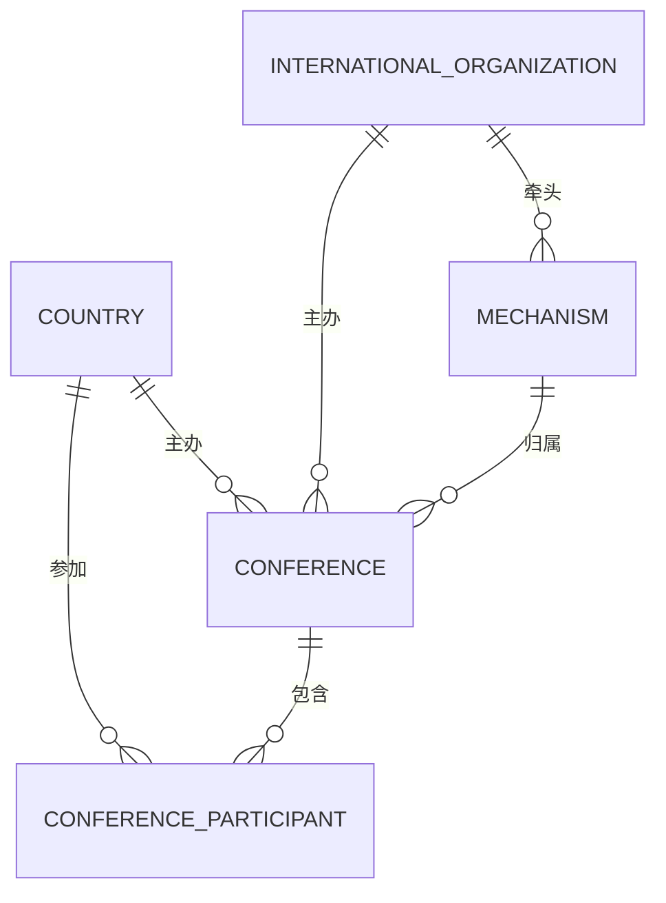
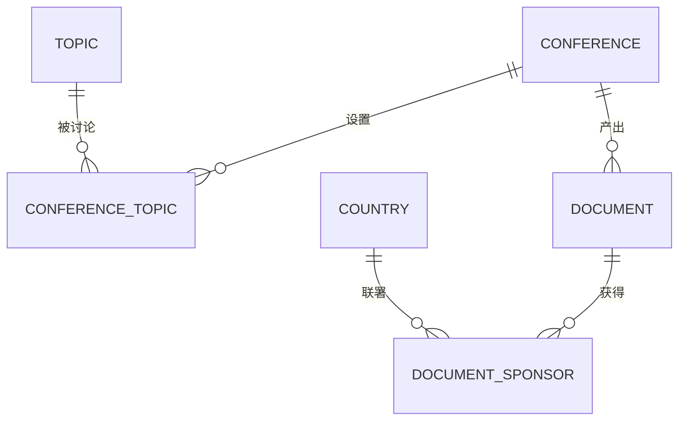
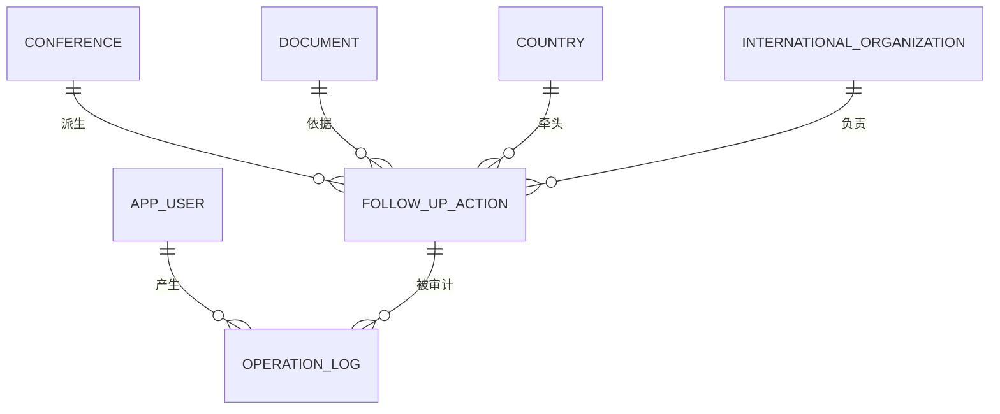
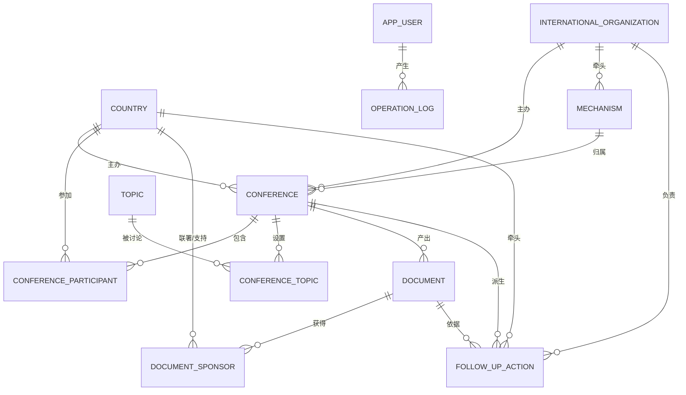

# 多边外交视角下国际会议与外交活动管理系统

《数据库原理》三级项目 · 选题 3 · 思政主题：多边外交 / 全球治理 · 难度系数 1.0（★★★）

数据库名：`` `multilateral-diplomacy-system-schoolwork-` ``（与仓库同名；含连字符，SQL 中必须加反引号）

> 本文件按历年优秀作品的报告骨架组织：系统分析 → 概念模型 → 逻辑模型 → 物理模型 → 数据库实现 → 总结。

---

## 第 1 章 系统分析

### 1.1 课题背景

多边外交活动是参与全球治理的主要形式。一场国际会议从筹备到收尾涉及主办国、参与国、国际组织、议题设置、成果文件、后续行动等多类对象，传统用文件与表格分散管理带来三类问题：会议与参会信息难以按机制汇总；成果文件与支持国之间缺乏可核验的对应关系；文件条款落地为行动后无人跟踪进度，逾期无预警。

本系统把"**国际会议 — 参与国家 — 议题 — 成果文件 — 后续行动**"建成一条可查询、可追踪、可审计的数据链。

### 1.2 需求分析

按使用角色划分需求（角色对应 `app_user.user_role`）：

| 角色 | 核心需求 |
|---|---|
| 系统管理员 | 账号与角色维护、操作留痕可追溯、数据备份还原 |
| 会议组织者 | 会议建档、参会登记、议题挂接、成果文件登记与联署记录 |
| 外交官 | 查询本国参会身份与出席级别、查看联署文件、跟踪牵头行动进度 |
| 观察员 | 只读查询会议全景与共识广度统计 |

功能需求归纳为六个模块：

1. **会议管理**：会议建档（机制、主办国、会期、形式、状态）
2. **参会管理**：国家参会登记（身份、出席级别、代表团规模）
3. **议题管理**：议题库维护与会议议题挂接（核心议题标记）
4. **成果文件管理**：文件登记（类型、编号、通过方式、状态）与联署国立场
5. **行动跟踪**：文件条款拆解为后续行动，进度与完成日期跟踪、逾期自动预警
6. **系统管理**：用户角色、操作审计

### 1.3 功能描述

```
                     ┌─────────────────────────────┐
                     │  多边外交会议与活动管理系统   │
                     └──────────────┬──────────────┘
   ┌──────────┬──────────┬──────────┼──────────┬──────────┬──────────┐
 会议管理   参会管理   议题管理   成果文件    行动跟踪   系统管理
   │          │          │          │          │          │
 会议建档   参会登记   议题挂接   文件登记   行动拆解   用户角色
 机制归属   身份级别   核心标记   联署立场   进度更新   操作审计
 会期形式   代表团规模 讨论要点   共识统计   逾期预警   数据备份
```

### 1.4 可行性分析

- **技术可行性**：MySQL 9.4 完整支持外键、CHECK、ENUM、窗口函数、触发器与存储过程，本设计所需能力全部原生提供，无需额外组件。
- **数据可行性**：外交部官网、国际组织公开发布的议程与会议成果足以支撑示例数据（本库 18 国 / 9 场会议 / 11 份文件）。
- **经济可行性**：全流程在单机完成，无授权费用。
- **操作可行性**：Navicat 图形界面 + 命令行脚本两条路径，组织者无需编程即可录入。

---

## 第 2 章 概念模型设计

按业务边界拆成三个局部 E-R 模型，再合成全局模型。

### 2.1 局部 E-R 模型

**（1）会议组织域**：回答"谁在什么机制下办了什么会、谁来了"。



**（2）议程与成果域**：回答"会上谈了什么、谈成了什么、谁赞同"。



**（3）行动与审计域**：回答"文件条款落实得怎么样、谁改的数据"。



### 2.2 全局 E-R 模型



---

## 第 3 章 逻辑模型设计

### 3.1 实体类型的转换

10 个独立实体各转换为一个关系，实体标识符作主键：

| 实体 | 关系 | 主键 |
|---|---|---|
| 国家 | `country` | `country_id` |
| 国际组织 | `international_organization` | `org_id` |
| 多边机制 | `mechanism` | `mechanism_id` |
| 议题 | `topic` | `topic_id` |
| 国际会议 | `conference` | `conference_id` |
| 成果文件 | `document` | `document_id` |
| 后续行动 | `follow_up_action` | `action_id` |
| 系统用户 | `app_user` | `user_id` |
| 操作日志 | `operation_log` | `log_id` |

> 说明：实体标识符统一采用**无业务含义的自增代理键**，业务唯一性（`iso_code`、`doc_no`、`username` 等）另以 UNIQUE 约束保证。

### 3.2 联系类型的转换

| 原有联系 | 类型 | 转换方式 | 结果关系 |
|---|---|---|---|
| 国家—会议 | M:N | 新建关系，取双方主键为联合主键，加入联系属性 | `conference_participant`（身份、级别、人数、确认日期） |
| 会议—议题 | M:N | 同上 | `conference_topic`（核心标记、讨论日期、要点） |
| 文件—国家 | M:N | 同上 | `document_sponsor`（立场：联署/支持/保留） |
| 会议—文件 | 1:N | 在 N 端加入 1 端主键作外键 | `document.conference_id` |
| 会议—行动 | 1:N | 同上 | `follow_up_action.conference_id` |
| 文件—行动 | 1:N（可空） | 同上，允许为空（行动可只挂会议） | `follow_up_action.document_id` |
| 组织—机制 | 1:N | 同上 | `mechanism.lead_org_id` |
| 用户—日志 | 1:N | 同上 | `operation_log.user_id` |

### 3.3 关系模型

```
country(country_id, iso_code, name_cn, name_en, continent, development_status, is_un_member, note)
international_organization(org_id, name_cn, abbr, org_type, founded_year, hq_city)
mechanism(mechanism_id, name, abbr, category, founded_year, lead_org_id, description)
topic(topic_id, name, category, description)
conference(conference_id, title, short_name, mechanism_id, org_id, host_country_id,
           host_city, conference_type, session_label, start_date, end_date, format, status, theme)
conference_participant(participant_id, conference_id, country_id, role, delegation_level,
                       delegation_size, join_date)
conference_topic(conference_id, topic_id, is_core, discussion_date, summary)
document(document_id, conference_id, title, doc_type, doc_no, issue_date, adopt_method, status, summary)
document_sponsor(document_id, country_id, stance)
follow_up_action(action_id, conference_id, document_id, action_name, lead_country_id,
                 responsible_org_id, start_date, planned_end_date, actual_end_date, progress_pct, status, remarks)
app_user(user_id, username, real_name, user_role, country_id, org_id, is_active, created_at)
operation_log(log_id, user_id, action_type, target_table, target_id, old_value, new_value, log_time, detail)
```

### 3.4 范式判断及关系模型优化

#### 3.4.1 第一范式（1NF）的判断及转化

所有关系的每个属性值都是不可再分的原子值：联系方式只存单个号码、日期用 DATE/DATETIME 而非"年月日"拼接、立场与状态用 ENUM 取值。**数据库模式为 1NF。**

#### 3.4.2 第二范式（2NF）的判断及转化

先给出函数依赖：

```
country_id   → iso_code, name_cn, name_en, continent, development_status, is_un_member
org_id       → name_cn, abbr, org_type, founded_year, hq_city
mechanism_id → name, category, lead_org_id
conference_id→ title, short_name, mechanism_id, host_country_id, start_date, end_date, status
document_id  → conference_id, title, doc_type, doc_no, issue_date, adopt_method, status
action_id    → conference_id, action_name, lead_country_id, planned_end_date, progress_pct, status
(conference_id, country_id) → role, delegation_level, delegation_size, join_date
(conference_id, topic_id)   → is_core, discussion_date, summary
(document_id, country_id)   → stance
```

三个复合主键关系的非主属性都依赖**整个**联合主键而非其中一部分：参会身份依赖"哪场会议 + 哪个国家"，文件立场依赖"哪份文件 + 哪个国家"，不存在只依赖半边主键的属性。**所有关系均为 2NF。**

#### 3.4.3 第三范式（3NF）的判断及转化

检查非主属性对候选键的传递依赖，设计时已消除三处典型传递链：

| 潜在传递依赖 | 处理方式 |
|---|---|
| 会议 → 主办国 → 主办国大洲/发展水平 | 会议只存 `host_country_id`，国名与大洲留在 `country` 一处 |
| 文件 → 所属会议 → 会议名称/会期 | 文件只存 `conference_id`，会议信息不冗余 |
| 机制 → 牵头组织 → 组织总部/成立年份 | 机制只存 `lead_org_id`，组织信息不重复 |

同时**不冗余统计字段**（某会议的参与国数、文件数、行动完成数），全部由视图实时聚合，避免"明细改了、统计没改"的更新异常。**所有关系均为 3NF。**

#### 3.4.4 BC 范式（BCNF）的判断及转化

BCNF 要求每个决定因素都是候选键。逐类检查：

- 单属性候选键关系（`country` 等）：决定因素即主键，平凡成立。
- 存在多个候选键的关系：`country` 的候选键有 `country_id` 与 `iso_code`，其余属性对两者都是完全依赖，无属性决定另一候选键；`document` 同理（`document_id` 与 `doc_no`）。
- 复合候选键关系（`conference_topic`、`document_sponsor`）：非主属性不决定任何主属性，`stance` 只由"文件+国家"共同决定。

**所有关系模式均为 BCNF。**

#### 3.4.5 关系模型优化（与常见做法的对比）

| 常见做法 | 本设计的改进 | 原因 |
|---|---|---|
| 用身份证号 / 业务编号当主键 | `iso_code`、`doc_no`、`username` 仅作 UNIQUE，主键用自增代理键 | 业务码会改，改主键要级联更新所有引用行 |
| 会议表直接存主办国名称 | 只存 `host_country_id` | 消除传递依赖，改名只改一处 |
| 参会记录用"国家列表"字段 | 拆 `conference_participant` 关系并带联系属性 | 满足 1NF，且能按身份/级别统计 |
| 行动完成状态靠人填 | 触发器按 `planned_end_date` 自动判定逾期 | 业务规则落到数据库层，避免漏填 |
| 无审计 | `operation_log` + AFTER UPDATE 触发器 | 状态与进度变更自动留痕 |

---

## 第 4 章 物理模型设计

### 4.1 数据字典

#### 表 4-1  country 参与国家表

| 序号 | 列名 | 类型 | 允许空 | 键 | 默认值 | 说明 |
|---|---|---|---|---|---|---|
| 1 | `country_id` | int | 否 | 主键 |  | 国家ID auto_increment |
| 2 | `iso_code` | char(3) | 否 | 唯一 |  | ISO三位代码 |
| 3 | `name_cn` | varchar(50) | 否 | 唯一 |  | 国家名称(中文) |
| 4 | `name_en` | varchar(80) | 否 |  |  | 国家名称(英文) |
| 5 | `continent` | enum('亚洲','欧洲','非洲','北美洲','南美洲','大洋洲') | 否 | 索引 |  | 所属大洲 |
| 6 | `development_status` | enum('发达国家','发展中国家','最不发达国家') | 否 |  | 发展中国家 | 发展水平 |
| 7 | `is_un_member` | tinyint(1) | 否 |  | 1 | 是否联合国成员国 |
| 8 | `note` | varchar(200) | 是 |  |  | 备注 |

#### 表 4-2  international_organization 国际组织表

| 序号 | 列名 | 类型 | 允许空 | 键 | 默认值 | 说明 |
|---|---|---|---|---|---|---|
| 1 | `org_id` | int | 否 | 主键 |  | 组织ID auto_increment |
| 2 | `name_cn` | varchar(80) | 否 | 唯一 |  | 组织中文名 |
| 3 | `abbr` | varchar(20) | 是 | 唯一 |  | 组织简称 |
| 4 | `org_type` | enum('联合国系统','区域性组织','多边机制','专门机构') | 否 |  |  | 组织类型 |
| 5 | `founded_year` | year | 是 |  |  | 成立年份 |
| 6 | `hq_city` | varchar(50) | 是 |  |  | 总部所在地 |

#### 表 4-3  mechanism 多边机制表

| 序号 | 列名 | 类型 | 允许空 | 键 | 默认值 | 说明 |
|---|---|---|---|---|---|---|
| 1 | `mechanism_id` | int | 否 | 主键 |  | 机制ID auto_increment |
| 2 | `name` | varchar(80) | 否 | 唯一 |  | 机制名称 |
| 3 | `abbr` | varchar(20) | 是 |  |  | 机制简称 |
| 4 | `category` | enum('全球治理','区域合作','南南合作','大国协调','专门领域') | 否 |  |  | 机制类别 |
| 5 | `founded_year` | year | 是 |  |  | 启动年份 |
| 6 | `lead_org_id` | int | 是 | 索引 |  | 牵头组织 |
| 7 | `description` | varchar(200) | 是 |  |  | 机制说明 |

#### 表 4-4  topic 议题表

| 序号 | 列名 | 类型 | 允许空 | 键 | 默认值 | 说明 |
|---|---|---|---|---|---|---|
| 1 | `topic_id` | int | 否 | 主键 |  | 议题ID auto_increment |
| 2 | `name` | varchar(60) | 否 | 唯一 |  | 议题名称 |
| 3 | `category` | enum('和平与安全','发展与合作','气候变化','公共卫生','人文交流','全球治理体系') | 否 | 索引 |  | 议题领域 |
| 4 | `description` | varchar(200) | 是 |  |  | 议题说明 |

#### 表 4-5  conference 国际会议表

| 序号 | 列名 | 类型 | 允许空 | 键 | 默认值 | 说明 |
|---|---|---|---|---|---|---|
| 1 | `conference_id` | int | 否 | 主键 |  | 会议ID auto_increment |
| 2 | `title` | varchar(120) | 否 |  |  | 会议全称 |
| 3 | `short_name` | varchar(60) | 是 |  |  | 会议简称 |
| 4 | `mechanism_id` | int | 是 | 索引 |  | 所属机制 |
| 5 | `org_id` | int | 是 | 索引 |  | 主办国际组织 |
| 6 | `host_country_id` | int | 否 | 索引 |  | 主办/承办国家 |
| 7 | `host_city` | varchar(60) | 是 |  |  | 举办城市 |
| 8 | `conference_type` | enum('首脑峰会','部长级会议','高官会议','专家会议','大会','特别会议') | 否 |  |  | 会议类型 |
| 9 | `session_label` | varchar(20) | 是 |  |  | 届次(如 第24次) |
| 10 | `start_date` | date | 否 | 索引 |  | 开始日期 |
| 11 | `end_date` | date | 否 |  |  | 结束日期 |
| 12 | `format` | enum('线下','线上','混合') | 否 |  | 线下 | 会议形式 |
| 13 | `status` | enum('筹备中','进行中','已闭幕','取消') | 否 |  | 已闭幕 | 会议状态 |
| 14 | `theme` | varchar(200) | 是 |  |  | 会议主题 |

#### 表 4-6  conference_participant 会议参与国家表

| 序号 | 列名 | 类型 | 允许空 | 键 | 默认值 | 说明 |
|---|---|---|---|---|---|---|
| 1 | `participant_id` | int | 否 | 主键 |  | 参与记录ID auto_increment |
| 2 | `conference_id` | int | 否 | 索引 |  | 会议ID |
| 3 | `country_id` | int | 否 | 索引 |  | 国家ID |
| 4 | `role` | enum('主办国','主席国','成员国','观察员','嘉宾国') | 否 |  | 成员国 | 参会身份 |
| 5 | `delegation_level` | enum('元首级','政府首脑级','外交部长级','部长级','高官级','专家级') | 否 |  | 部长级 | 出席级别 |
| 6 | `delegation_size` | int | 否 |  | 0 | 代表团人数 |
| 7 | `join_date` | date | 是 |  |  | 确认参会日期 |

#### 表 4-7  conference_topic 会议议题关联表

| 序号 | 列名 | 类型 | 允许空 | 键 | 默认值 | 说明 |
|---|---|---|---|---|---|---|
| 1 | `conference_id` | int | 否 | 主键 |  | 会议ID |
| 2 | `topic_id` | int | 否 | 主键 |  | 议题ID |
| 3 | `is_core` | tinyint(1) | 否 |  | 0 | 是否核心议题 |
| 4 | `discussion_date` | date | 是 |  |  | 讨论日期 |
| 5 | `summary` | varchar(300) | 是 |  |  | 议题讨论要点 |

#### 表 4-8  document 成果文件表

| 序号 | 列名 | 类型 | 允许空 | 键 | 默认值 | 说明 |
|---|---|---|---|---|---|---|
| 1 | `document_id` | int | 否 | 主键 |  | 文件ID auto_increment |
| 2 | `conference_id` | int | 否 | 索引 |  | 所属会议 |
| 3 | `title` | varchar(120) | 否 |  |  | 文件名称 |
| 4 | `doc_type` | enum('联合声明','联合公报','决议','行动计划','谅解备忘录','倡议') | 否 | 索引 |  | 文件类型 |
| 5 | `doc_no` | varchar(40) | 是 | 唯一 |  | 文件编号 |
| 6 | `issue_date` | date | 否 |  |  | 发布/通过日期 |
| 7 | `adopt_method` | enum('协商一致','表决通过') | 否 |  | 协商一致 | 通过方式 |
| 8 | `status` | enum('草案','已通过','已生效') | 否 |  | 已通过 | 文件状态 |
| 9 | `summary` | varchar(300) | 是 |  |  | 内容概要 |

#### 表 4-9  document_sponsor 文件联署国家表

| 序号 | 列名 | 类型 | 允许空 | 键 | 默认值 | 说明 |
|---|---|---|---|---|---|---|
| 1 | `document_id` | int | 否 | 主键 |  | 文件ID |
| 2 | `country_id` | int | 否 | 主键 |  | 国家ID |
| 3 | `stance` | enum('联署','支持','保留') | 否 |  | 联署 | 国别立场 |

#### 表 4-10  follow_up_action 后续行动表

| 序号 | 列名 | 类型 | 允许空 | 键 | 默认值 | 说明 |
|---|---|---|---|---|---|---|
| 1 | `action_id` | int | 否 | 主键 |  | 行动ID auto_increment |
| 2 | `conference_id` | int | 否 | 索引 |  | 来源会议 |
| 3 | `document_id` | int | 是 | 索引 |  | 依据文件 |
| 4 | `action_name` | varchar(120) | 否 |  |  | 行动名称 |
| 5 | `lead_country_id` | int | 否 | 索引 |  | 牵头国家 |
| 6 | `responsible_org_id` | int | 是 | 索引 |  | 责任国际组织 |
| 7 | `start_date` | date | 否 |  |  | 启动日期 |
| 8 | `planned_end_date` | date | 否 | 索引 |  | 计划完成日期 |
| 9 | `actual_end_date` | date | 是 |  |  | 实际完成日期(未完成为NULL) |
| 10 | `progress_pct` | int | 否 |  | 0 | 进度百分比 |
| 11 | `status` | enum('未启动','进行中','已完成','逾期','终止') | 否 |  | 进行中 | 行动状态 |
| 12 | `remarks` | varchar(200) | 是 |  |  | 备注 |

#### 表 4-11  app_user 系统用户表

| 序号 | 列名 | 类型 | 允许空 | 键 | 默认值 | 说明 |
|---|---|---|---|---|---|---|
| 1 | `user_id` | int | 否 | 主键 |  | 用户ID auto_increment |
| 2 | `username` | varchar(40) | 否 | 唯一 |  | 登录账号 |
| 3 | `real_name` | varchar(40) | 否 |  |  | 姓名 |
| 4 | `user_role` | enum('系统管理员','会议组织者','外交官','观察员') | 否 | 索引 | 观察员 | 角色 |
| 5 | `country_id` | int | 是 | 索引 |  | 所属国家 |
| 6 | `org_id` | int | 是 | 索引 |  | 所属国际组织 |
| 7 | `is_active` | tinyint(1) | 否 |  | 1 | 是否启用 |
| 8 | `created_at` | datetime | 否 |  | CURRENT_TIMESTAMP | 创建时间 DEFAULT_GENERATED |

#### 表 4-12  operation_log 操作审计表

| 序号 | 列名 | 类型 | 允许空 | 键 | 默认值 | 说明 |
|---|---|---|---|---|---|---|
| 1 | `log_id` | bigint | 否 | 主键 |  | 日志ID auto_increment |
| 2 | `user_id` | int | 是 | 索引 |  | 操作人(周界外为NULL) |
| 3 | `action_type` | enum('INSERT','UPDATE','DELETE') | 否 |  |  | 操作类型 |
| 4 | `target_table` | varchar(40) | 否 | 索引 |  | 目标表 |
| 5 | `target_id` | int | 是 |  |  | 目标记录主键 |
| 6 | `old_value` | varchar(200) | 是 |  |  | 变更前摘要 |
| 7 | `new_value` | varchar(200) | 是 |  |  | 变更后摘要 |
| 8 | `log_time` | datetime | 否 | 索引 | CURRENT_TIMESTAMP | 记录时间 DEFAULT_GENERATED |
| 9 | `detail` | varchar(300) | 是 |  |  | 说明 |

### 4.2 索引设计

| 索引 | 所在表 | 作用 |
|---|---|---|
| `idx_conf_dates(start_date, end_date)` | conference | 按时间范围筛会（查询 1、11） |
| `idx_conf_mechanism` / `idx_conf_host` / `idx_conf_org` | conference | 外键与按机制/主办国聚合（查询 2、5） |
| `idx_participant_country` | conference_participant | 按国家反查参会记录（查询 9） |
| `idx_ct_topic` | conference_topic | 议题热度统计（查询 8） |
| `idx_doc_conf` / `idx_doc_type` | document | 按会议取文件、按类型统计 |
| `idx_sponsor_country` | document_sponsor | 共识广度与国别联署统计（查询 7） |
| `idx_action_due(planned_end_date)` | follow_up_action | 逾期预警范围扫描（查询 6） |
| `idx_log_time` / `idx_log_target` | operation_log | 审计按时间倒序、按对象追溯 |

原则：外键列必建索引（InnoDB 外键检查需要）；高频过滤列建单列索引；范围查询用组合索引并把等值列放前面。全库共 12 张表、44 个索引（含主键与唯一键）。

### 4.3 数据量估算与存储

| 对象 | 单行估算 | 3 年规模 | 空间估算 |
|---|---|---|---|
| conference | ~400 B | 500 场 | 0.2 MB |
| conference_participant | ~120 B | 2 万条 | 2.4 MB |
| document_sponsor | ~30 B | 3 万条 | 0.9 MB |
| follow_up_action | ~300 B | 5000 条 | 1.5 MB |
| operation_log | ~300 B | 10 万条 | 30 MB |
| 合计 | — | — | < 50 MB |

参数选择：存储引擎 `InnoDB`（事务 + 外键）、字符集 `utf8mb4`（中文与符号无损）、排序规则 `utf8mb4_0900_ai_ci`；日志表主键用 `BIGINT` 为增长预留；时间统一 `DATE`（业务日）与 `DATETIME`（日志时刻）。

---

## 第 5 章 数据库实现

### 5.1 脚本清单与执行顺序

| 顺序 | 文件 | 对应内容 |
|---|---|---|
| 1 | `01_create_database.sql` | 建库（utf8mb4） |
| 2 | `02_create_tables.sql` | 12 张表 + 主键/外键/CHECK/UNIQUE + 索引 |
| 3 | `03_insert_data.sql` | 示例数据（可重复执行） |
| 4 | `04_views.sql` | 5 个视图 |
| 5 | `06_routines.sql` | 3 触发器 + 1 存储过程 + 1 函数 |
| 6 | `05_queries.sql` | 14 条核心查询 |
| 7 | `07_crud_samples.sql` | 增删改查样例（事务内演示，末尾 ROLLBACK） |
| 8 | `99_verify.sql` | 验收自检 |

### 5.2 数据规模

| 表 | 行数 | 表 | 行数 |
|---|---|---|---|
| country | 18 | document | 11 |
| international_organization | 6 | document_sponsor | 76 |
| mechanism | 6 | follow_up_action | 16 |
| topic | 10 | app_user | 10 |
| conference | 9 | operation_log | 4（触发器生成） |
| conference_participant | 66 | conference_topic | 27 |

### 5.3 增删改查样例（`07_crud_samples.sql`）

一段显式事务里完整演示四类操作，实测输出：

| 操作 | 语句要点 | 实测结果 |
|---|---|---|
| INSERT | 新建上合 2026 峰会 + 4 国参会 + 2 议题 + 1 文件 + 3 联署 + 1 行动 | `conference_id=10`，连带 4/2/1 条明细 |
| 触发器联动 | 插入行动时计划完成日期已过 | 状态自动判为 **逾期** |
| UPDATE | 补录完成日期与进度 100% | 触发器改判 **已完成**，并写入审计日志 |
| 审计 | 查询 `operation_log` | 记录 `status=逾期, progress=30 → status=已完成, progress=100` |
| DELETE | 撤销误登记的观察员与该行动 | 该会议参与国数 4 → 3 |
| ROLLBACK | 回滚整个演示事务 | 会议 9 / 行动 16 / 文件 11，与演示前一致 |

### 5.4 约束与触发器实测

| 测试 | 实际结果 |
|---|---|
| 参会国 `country_id = 999` | `ERROR 1452` 外键约束失败 |
| 进度改为 150 | `ERROR 3819` `ck_action_progress` 被违反 |
| 重复 `iso_code = 'CHN'` | `ERROR 1062` 唯一键冲突 |
| 会议状态填"已延期" | `ERROR 1265` 非法枚举值被拒 |
| 删除被引用的国家 | `ERROR 1451` 外键 `ON DELETE RESTRICT` 阻止 |
| 16 项行动按当前日期重算 | 4 项由"进行中"自动改判**逾期**，并各写 1 条审计日志 |

### 5.5 核心查询一览（14 条，全部实测跑通）

| # | 查询 | 技术点 | 结果 |
|---|---|---|---|
| 1 | 会议全景 | 4 表连接 + 视图 | 9 行 |
| 2 | 机制维度统计 | 多重 `COUNT(DISTINCT)` | 金砖 3 会居首 |
| 3 | 参与国 ≥ 8 的会议 | `HAVING` | G20、UNGA79（各 10 国） |
| 4 | 无后续行动的成果文件 | `NOT EXISTS` | 1 份草案 |
| 5 | 各国主办会议数排名 | `DENSE_RANK` | 巴西 2 场第 1 |
| 6 | 行动逾期预警 | 视图 + `DATEDIFF` | 4 项，最长 475 天 |
| 7 | 文件共识广度 | 条件聚合 + `LIMIT` | G20 宣言 10 国全联署 |
| 8 | 议题热度 | 分组 + 条件求和 | 全球治理体系 6 会 |
| 9 | 中国参与全景 | 视图（思政） | 9 场逐场列出身份与联署数 |
| 10 | 行动状态分布 | 条件计数 | 进行中 7 / 逾期 4 / 已完成 3 / 未启动 1 / 终止 1 |
| 11 | 年度会议统计 | `YEAR()` | 2024 年 7 场 55 国次 |
| 12 | 全链条汇总 | `GROUP_CONCAT` | 每会议议题链/文件/完成数 |
| 13 | 用户角色分布 | 分组 + 条件求和 | 外交官 4 / 组织者 3 / 观察员 2 / 管理员 1 |
| 14 | 操作审计日志 | 视图 + 排序 | 4 条触发器留痕 |

### 5.6 视图 / 触发器 / 例程

| 类型 | 名称 | 作用 |
|---|---|---|
| 视图 | `v_conference_overview` | 会议全景（参与国/议题/文件/行动计数） |
| 视图 | `v_document_consensus` | 文件共识广度（联署/支持/保留分项） |
| 视图 | `v_action_alert` | 逾期行动预警（含逾期天数） |
| 视图 | `v_china_multilateral` | 中国多边参与全景（思政报表） |
| 视图 | `v_operation_audit` | 操作审计（关联用户与角色） |
| 触发器 | `trg_action_before_insert` | 插入时按计划日期判定逾期 |
| 触发器 | `trg_action_before_update` | 更新时按完成日期判定已完成并置进度 100 |
| 触发器 | `trg_action_audit` | 状态/进度变化写审计日志 |
| 存储过程 | `sp_conference_dashboard(会议ID)` | 一次输出 5 个结果集（基本信息/参会/议题/文件含共识率/行动） |
| 函数 | `fn_consensus_ratio(文件ID)` | 文件联署率（%） |

### 5.7 整库备份（可直接还原，不用逐条跑脚本）

[`backup/multilateral-diplomacy-system-schoolwork-_full.sql`](backup/multilateral-diplomacy-system-schoolwork-_full.sql)
是 `mysqldump` 导出的**整库备份**（58 KB），包含：

| 内容 | 数量 |
|---|---|
| `CREATE DATABASE` + `USE` | 1（库名与仓库同名，含连字符） |
| 建表语句 `CREATE TABLE` | 12 张基础表（含主键/外键/CHECK/唯一键） |
| 数据 `INSERT` | 12 组，共 259 行 |
| 视图 `CREATE VIEW` | 5 个 |
| 触发器 `CREATE TRIGGER` | 3 个 |
| 存储过程 / 函数 | `sp_conference_dashboard` / `fn_consensus_ratio` |
| 字符集 | `utf8mb4`，中文不会乱码 |

生成命令（本机实测）：

```powershell
$dump = "C:\Program Files\MySQL\MySQL Server 9.4\bin\mysqldump.exe"
& $dump -u root --default-character-set=utf8mb4 --single-transaction --set-gtid-purged=OFF `
        --routines --triggers --events --databases 'multilateral-diplomacy-system-schoolwork-' `
        --result-file="project\backup\multilateral-diplomacy-system-schoolwork-_full.sql"
```

还原（一条命令，会先建库再建表灌数据）：

```powershell
$mysql = "C:\Program Files\MySQL\MySQL Server 9.4\bin\mysql.exe"
cmd /c "`"$mysql`" -u root --default-character-set=utf8mb4 < project\backup\multilateral-diplomacy-system-schoolwork-_full.sql"
```

**还原实测**：导入到临时库后逐表 `COUNT(*)` 比对，12 张表行数与原库完全一致
（18/6/6/10/9/66/27/11/76/16/10/4），视图 5、触发器 3、例程 2 全部在；比对完临时库已删除。

> 注意：`mysqldump` 的 `--databases` 会带上 `DROP`/`CREATE DATABASE` 语义，还原到本机会**覆盖同名库**；
> 若只想看结构不动数据，用 `mysql -e "SHOW CREATE TABLE ..."` 或打开备份文件搜索 `CREATE TABLE`。

---

## 第 6 章 总结

### 6.1 遇到的问题与解决方法

| 问题 | 原因 | 解决 |
|---|---|---|
| 批量导入时报 `ERROR 1265 Data truncated`，后面几张表全空 | ENUM 取值写错（"总理级"不在枚举内），严格模式下该语句中止 | 枚举值统一在 02 定义处核对；导入后逐表 `COUNT(*)` 校验 |
| 自检脚本显示行动表 0 行，实际有 16 行 | `information_schema.table_rows` 是 InnoDB 估算值 | 改用 `COUNT(*)` |
| 库名含连字符导致语法错误 | 标识符需反引号 | 全库 SQL 统一反引号；命令行可用 `-D` 传库名 |
| 重跑脚本时主键冲突 / 数据翻倍 | 脚本不幂等 | 建表前 `DROP IF EXISTS`、插入前 `TRUNCATE`，按外键逆序清理 |
| 一键脚本双击报"未对文件进行数字签名" | Windows 默认执行策略 | 提供 `.cmd` 外壳用 `-ExecutionPolicy Bypass` 只对本次放行 |

### 6.2 心得体会

> （本节由本人撰写：围绕多边外交数据建模的取舍、范式与业务规则如何落到数据库层、以及团队分工与答辩准备的体会。）

---

## 附 A：评分点对照

| 评分维度（三级项目） | 分值 | 对应内容 |
|---|---|---|
| 项目完整度（需求与流程） | 10 | 1.2 角色需求 + 1.3 功能模块 + 第 5 章完整闭环 |
| 关系模型设计（ER 图与逻辑） | 20 | 2.1 三个局部 E-R + 2.2 全局 E-R；3.1–3.3 转换；3.4 的 1NF→BCNF 判定；18 外键 / 7 CHECK / 9 UNIQUE 全生效 |
| 思政元素体现 | 10 | 1.1 背景；`v_china_multilateral`；查询 7/9 量化共识广度与发展中国家代表性 |
| 功能概述与数据（实现） | 30 | 14 条查询实测；12 张表数据覆盖 5 类会议/4 种身份/6 域议题/8 类文件/5 种行动状态；5.3 CRUD 演示；5.4 约束实测 |
| 展示（验收演示） | 30 | `run_all.cmd` 一键重建；`99_verify.sql` 自检；`CALL sp_conference_dashboard(3)` 一屏看全链条 |
| 加分项 | 10 | 逾期预警 + 审计触发器 + 窗口函数 + 分组拼接报表 + 5 视图 + 1 过程 1 函数 + 事务演示 |

## 附 B：答辩演示清单

1. `run_all.cmd` 一键重建 → 停在 `99_verify` 输出（表齐、约束齐、对象齐）
2. Navicat 展开库 → 12 张表、外键连线、`follow_up_action` 的 4 个 CHECK
3. 跑 `07_crud_samples.sql` → 增删改查 + 触发器联动 + 审计留痕 + 事务回滚
4. 跑 5.4 的四条非法写入 → 约束不是摆设
5. `CALL sp_conference_dashboard(3);` → 中非论坛北京峰会全链条一屏看完
6. 查询 6 逾期预警 + 查询 9 中国参与全景 → 思政落到数据上

**需要截图的位置**：库与表树、每表设计视图、外键页、各表数据、约束报错、14 条查询结果、过程输出、审计日志。
