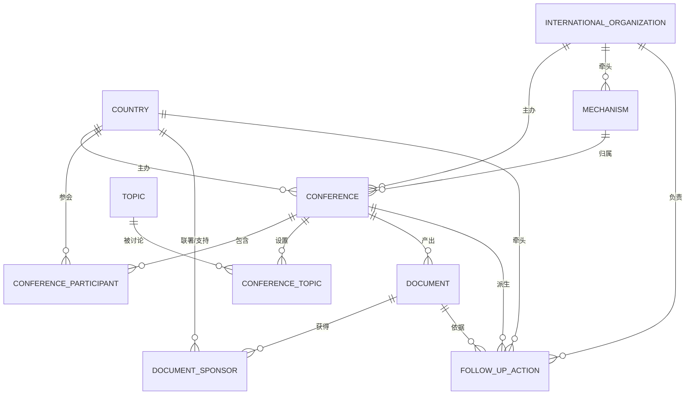

# 多边外交视角下国际会议与外交活动管理系统

《数据库原理》三级项目 · 选题 3 · 主题：多边外交 / 全球治理 · 难度系数 1.0（★★★）

数据库名：`` `multilateral-diplomacy-system-schoolwork-` ``（与 GitHub 项目库同名；含连字符，**SQL 中必须加反引号**）

---

## 一、项目定位与思政主题

系统面向多边外交活动的组织协调与成果跟踪，管理
**国际会议 — 参与国家 — 议题 — 成果文件 — 后续行动** 全要素数据。

思政落点（答辩时可讲）：

| 外交思想主题 | 在系统里的落点 |
|---|---|
| 多边外交 | 每场会议的参与国、参会身份、出席级别完整留痕；`document_sponsor` 记录每份成果文件的联署/支持/保留立场 |
| 全球治理 | 议题按「和平与安全 / 发展与合作 / 气候变化 / 公共卫生 / 人文交流 / 全球治理体系」六域归口统计 |
| 共商共建共享 | 成果文件默认「协商一致」通过；`v_document_consensus` 直接量化共识广度 |
| 发展中国家代表性 | `country.development_status` + 安理会改革议题 + 按大洲统计参与度 |
| 成果导向 | `follow_up_action` 把文件条款变成可跟踪的行动，触发器自动判定逾期 |

---

## 二、需求分析

### 2.1 业务流程

1. **筹备**：确定机制（上合/金砖/中非/G20/COP/联大）、主办国、会期、形式；
2. **组织**：各国确认参会，登记身份（主办国/主席国/成员国/观察员/嘉宾国）与出席级别；
3. **议程**：为会议挂接议题，标记核心议题与讨论日期；
4. **成果**：会议通过联合声明/公报/决议/行动计划/备忘录/倡议，登记文件类型、编号、通过方式；
5. **共识**：记录各国对文件的态度（联署 / 支持 / 保留）；
6. **跟踪**：把文件条款拆成后续行动，指定牵头国与责任组织，跟踪进度与完成日期，逾期自动预警。

### 2.2 功能模块

| 模块 | 对应数据对象 | 支撑查询/视图 |
|---|---|---|
| 会议管理 | `conference` | 查询 1、5、11；`v_conference_overview` |
| 参会管理 | `conference_participant` | 查询 3、9；`v_china_multilateral` |
| 议题管理 | `topic`、`conference_topic` | 查询 8 |
| 成果文件 | `document`、`document_sponsor` | 查询 4、7；`v_document_consensus` |
| 行动跟踪 | `follow_up_action` | 查询 6、10、12；`v_action_alert` |
| 机制/组织 | `mechanism`、`international_organization` | 查询 2 |

---

## 三、概念模型（E-R）



联系类型说明：

| 联系 | 类型 | 说明 |
|---|---|---|
| 国家 — 会议 | M:N（经 `conference_participant`） | 带属性：参会身份、出席级别、代表团人数、确认日期 |
| 会议 — 议题 | M:N（经 `conference_topic`） | 带属性：是否核心议题、讨论日期、讨论要点 |
| 文件 — 国家 | M:N（经 `document_sponsor`） | 带属性：立场（联署/支持/保留） |
| 会议 — 文件 | 1:N | 一场会议可产出多份文件 |
| 会议 — 行动 | 1:N | 一场会议可派生多项后续行动 |
| 文件 — 行动 | 1:N（可空） | 行动可挂靠具体文件，也可只挂会议 |

---

## 四、关系模式与范式论证

10 个关系模式（下划线为主键，*斜体*为外键）：

```
country(country_id, iso_code, name_cn, name_en, continent, development_status, is_un_member, note)
international_organization(org_id, name_cn, abbr, org_type, founded_year, hq_city)
mechanism(mechanism_id, name, abbr, category, founded_year, *lead_org_id*, description)
topic(topic_id, name, category, description)
conference(conference_id, title, short_name, *mechanism_id*, *org_id*, *host_country_id*,
           host_city, conference_type, session_label, start_date, end_date, format, status, theme)
conference_participant(participant_id, *conference_id*, *country_id*, role, delegation_level,
                       delegation_size, join_date)
conference_topic(*conference_id*, *topic_id*, is_core, discussion_date, summary)
document(document_id, *conference_id*, title, doc_type, doc_no, issue_date, adopt_method, status, summary)
document_sponsor(*document_id*, *country_id*, stance)
follow_up_action(action_id, *conference_id*, *document_id*, action_name, *lead_country_id*,
                 *responsible_org_id*, start_date, planned_end_date, actual_end_date,
                 progress_pct, status, remarks)
```

**3NF 论证**（每个模式都已检验）：

- 所有属性均为原子值（1NF）：无重复组、无嵌套表；多值联系全部拆成独立关系（`conference_participant`、`conference_topic`、`document_sponsor`）。
- 2NF：所有非主属性完全依赖于候选键。`conference_topic` 与 `document_sponsor` 为复合主键，其非主属性 `is_core`、`discussion_date`、`summary`、`stance` 都依赖整个主键，不存在部分依赖。
- 3NF：不存在非主属性对主属性的传递依赖。典型判据：
  - `conference` 只存 `host_country_id`，不存主办国名称/大洲，消除了「会议 → 主办国 → 大洲」的传递依赖；
  - `document` 不冗余会议名称，`follow_up_action` 不冗余文件标题与牵头国名称；
  - `mechanism` 的牵头组织用 `lead_org_id` 外键引用 `international_organization`，而非重复存组织名称与总部。
- 主键均使用无业务含义的自增代理键（`*_id`），业务唯一性交给 `UNIQUE`（`iso_code`、`name_cn`、`doc_no`、(会议,国家)、(文件,国家)），避免主键变更引发级联。
- 唯一的"统计类"字段（各会议参与国数、文件数）**不做冗余存储**，全部由视图实时聚合，保证与明细一致（避免更新异常）。

---

## 五、表结构要点

| 表 | 行数 | 主键 / 关键约束 |
|---|---|---|
| `country` | 18 | PK `country_id`；UNIQUE `iso_code`、`name_cn` |
| `international_organization` | 6 | PK；UNIQUE `name_cn`、`abbr` |
| `mechanism` | 6 | PK；UNIQUE `name`；FK → 组织 |
| `topic` | 10 | PK；UNIQUE `name` |
| `conference` | 9 | PK；3 FK；CHECK `end_date >= start_date` |
| `conference_participant` | 66 | PK；(会议,国家) UNIQUE；2 FK；CHECK 人数 ≥ 0 |
| `conference_topic` | 27 | 复合 PK；2 FK |
| `document` | 11 | PK；UNIQUE `doc_no`；FK；CHECK 编号非空串 |
| `document_sponsor` | 76 | 复合 PK；2 FK |
| `follow_up_action` | 16 | PK；4 FK；**4 个 CHECK**（进度 0–100、日期合法、已完成必须有完成日期） |

合计：**15 个外键、7 个 CHECK 约束、8 个 UNIQUE 约束**，全部在库内生效（见第九节实测）。

---

## 六、示例数据

| 维度 | 覆盖情况 |
|---|---|
| 会议 | 9 场（2014→2026 跨度，2024 年 7 场集中），5 类会议类型，3 种状态（已闭幕 8 / 筹备中 1） |
| 机制 | 上合元首理事会、金砖领导人会晤、中非合作论坛、G20、COP、联大一般性辩论 —— 6 类全覆盖 |
| 国家 | 18 国，覆盖亚/欧/非/北美/南美 5 大洲，含最不发达国家 1 个 |
| 参会 | 66 条参会记录，含主办国/成员国/观察员/嘉宾国 4 种身份，元首级→专家级 6 档级别 |
| 议题 | 10 个议题挂接到 27 个「会议—议题」组合，核心议题 15 个 |
| 文件 | 11 份，覆盖联合声明/公报/决议/行动计划/倡议，含 1 份「草案」状态 |
| 共识 | 76 条立场记录，含联署/支持/保留三种 |
| 行动 | 16 项，覆盖未启动/进行中/已完成/逾期/终止 5 种状态 |

> 数据依据外交部官网、国际组织公开发布的议程与会议成果整理，**用于课程演示，非官方发布文本**。

---

## 七、核心查询（12 条，全部实测跑通）

| # | 查询 | 演示的技术点 | 实测结果 |
|---|---|---|---|
| 1 | 会议全景 | 4 表连接 + 视图 | 9 行，含主办国/机制/参与国数/文件数 |
| 2 | 机制维度统计 | 多表 LEFT JOIN + 多重 COUNT(DISTINCT) | 6 个机制，金砖 3 会 3 文件 19 国次居首 |
| 3 | 参与国 ≥ 8 的会议 | GROUP BY + HAVING | G20、UNGA79（均 10 国） |
| 4 | 无后续行动的成果文件 | NOT EXISTS 相关子查询 | 1 份（金砖 2026 草案） |
| 5 | 各国主办会议数排名 | 窗口函数 DENSE_RANK | 巴西 2 场第 1，其余 1 场并列第 2 |
| 6 | 行动逾期预警 | 视图 + DATEDIFF | 4 项逾期，最长逾期 475 天 |
| 7 | 文件共识广度 | 条件聚合 + ORDER BY LIMIT | G20 里约宣言 10 国全联署居首 |
| 8 | 议题热度 | 按领域分组 + 条件求和 | 全球治理体系 6 会 5 次核心 |
| 9 | 中国多边参与全景（思政报表） | 视图 + 相关子查询 | 9 场会议逐场列出中国身份/级别/联署数 |
| 10 | 行动状态分布 | 分组 + 条件计数 | 进行中 7 / 逾期 4 / 已完成 3 / 未启动 1 / 终止 1 |
| 11 | 年度会议统计 | YEAR() 分组 | 2024 年 7 场、55 国次 |
| 12 | 全链条汇总 | GROUP_CONCAT + 条件聚合 | 每场会议的议题链/文件/行动完成数 |

---

## 八、视图 / 触发器 / 存储过程

**视图（4 个）**

| 视图 | 作用 |
|---|---|
| `v_conference_overview` | 会议全景：主办国、机制、参与国数、核心议题数、文件数、行动数/完成数 |
| `v_document_consensus` | 成果文件共识广度：联署/支持/保留分项计数 |
| `v_action_alert` | 逾期行动预警：逾期天数、牵头国、进度 |
| `v_china_multilateral` | 中国参与的会议全景与文件联署情况（思政报表） |

**触发器（2 个）**：`trg_action_before_insert` / `trg_action_before_update`
→ 有实际完成日期则自动置为「已完成、进度 100%」；超过计划完成日期且未完成则自动置「逾期」。
实测：14 条手工标注为「进行中」的行动中，有 4 条被触发器按当前日期自动改判为「逾期」。

**存储过程（1 个）**：`sp_conference_dashboard(会议ID)` —— 一次输出 5 个结果集（基本信息 / 参与国家 / 议题 / 成果文件含共识率 / 后续行动），验收演示一条命令出全貌：
`CALL sp_conference_dashboard(3);`

**函数（1 个）**：`fn_consensus_ratio(文件ID)` → 返回该文件的联署国占比（%）。

---

## 九、约束实测（答辩可直接复现）

四条非法写入全部被数据库正确拒绝：

| 测试 | 语句要点 | 预期 / 实际 |
|---|---|---|
| 外键 | 参会国 `country_id = 999` | `ERROR 1452` 外键约束失败 |
| CHECK | 进度改为 150 | `ERROR 3819` `ck_action_progress` 被违反 |
| UNIQUE | 重复 `iso_code = 'CHN'` | `ERROR 1062` 唯一键冲突 |
| ENUM | 会议状态填「已延期」 | `ERROR 1265` 数据截断（非法枚举值） |

---

## 十、运行方法

**方式一：Navicat**
1. 左侧 `MySQL94` 连接 → 右键「刷新」→ 出现库 `multilateral-diplomacy-system-schoolwork-`；
2. 右键库 →「运行 SQL 文件」，依次执行 `01 → 02 → 03 → 04 → 06`；
3. 执行 `05` 看核心查询，执行 `99` 看验收自检。

**方式二：命令行 / 一键脚本**

```powershell
# 双击 run_all.cmd（会提示输入 MySQL 密码），自动依次执行 01→02→03→04→06→05→99
```

```bash
MYSQL="/c/Program Files/MySQL/MySQL Server 9.4/bin/mysql.exe"
"$MYSQL" -u root --default-character-set=utf8mb4 < 01_create_database.sql
# 其余文件同理，顺序同上
```

**文件说明**

| 文件 | 作用 |
|---|---|
| `01_create_database.sql` | 建库（utf8mb4） |
| `02_create_tables.sql` | 10 张表 + 主键/外键/CHECK/UNIQUE + 索引 |
| `03_insert_data.sql` | 示例数据（可重复执行：先 TRUNCATE） |
| `04_views.sql` | 4 个视图 |
| `05_queries.sql` | 12 条核心查询 |
| `06_routines.sql` | 2 触发器 + 1 存储过程 + 1 函数，并对已有行动重算状态 |
| `99_verify.sql` | 验收自检（行数/约束/外键/视图/例程/索引） |
| `run_all.cmd` / `run_all.ps1` | 一键重建 + 自检 |

⚠️ `01` 开头是 `DROP DATABASE IF EXISTS`，重跑会清空重建；`03` 会 TRUNCATE 所有表——演示前若改过数据，先备份。

---

## 十一、评分点对照

| 评分维度（三级项目） | 分值 | 本项目交付物 |
|---|---|---|
| 项目完整度（需求与流程） | 10 | 第二节业务流程 6 步 + 第三、七节完整闭环；6 个功能模块全部有表与查询支撑 |
| 关系模型设计（ER 图与逻辑） | 20 | 第三节 Mermaid E-R 图 + 联系类型表；第四节 10 个关系模式与 3NF 论证；15 外键 7 CHECK 全部生效 |
| 思政元素体现 | 10 | 第一节思政落点表；`v_china_multilateral` 中国参与全景；查询 5/7/8/9 直观呈现多边共识与发展中国家代表性 |
| 功能概述与数据（实现） | 30 | 第八节 12 条查询实测；第六节数据覆盖 5 类会议/4 种身份/6 域议题/8 类文件/5 种状态；第九节约束实测 |
| 展示（验收演示） | 30 | `run_all.cmd` 一键重建；`99_verify.sql` 自检；`CALL sp_conference_dashboard(3)` 一屏看全链条 |
| 加分项 | 10 | 逾期预警视图 + 触发器自动判定 + 窗口函数排名 + 分组拼接报表 + 4 个可复用视图 + 1 函数 1 过程 |

---

## 十二、答辩演示清单

1. `run_all.cmd` 一键重建 → 停在 `99_verify` 输出（表齐、约束齐、对象齐）；
2. Navicat 展开库 → 展示 10 张表、外键连线、`follow_up_action` 的 CHECK 约束；
3. 跑四条非法写入（第九节），说明约束不是摆设；
4. `CALL sp_conference_dashboard(3);` —— 中非合作论坛北京峰会全链条一屏看完；
5. 查询 6 逾期预警 + 查询 9 中国参与全景，把思政主题落到数据上；
6. 触发器现场演示：`UPDATE follow_up_action SET planned_end_date='2025-01-01' WHERE action_id=2;` → 状态自动变「逾期」。

**需要截图的位置**：库与表树、每表设计视图（字段/类型/约束）、外键页、各表数据、四条约束报错、12 条查询结果、5 个结果集的过程输出。
