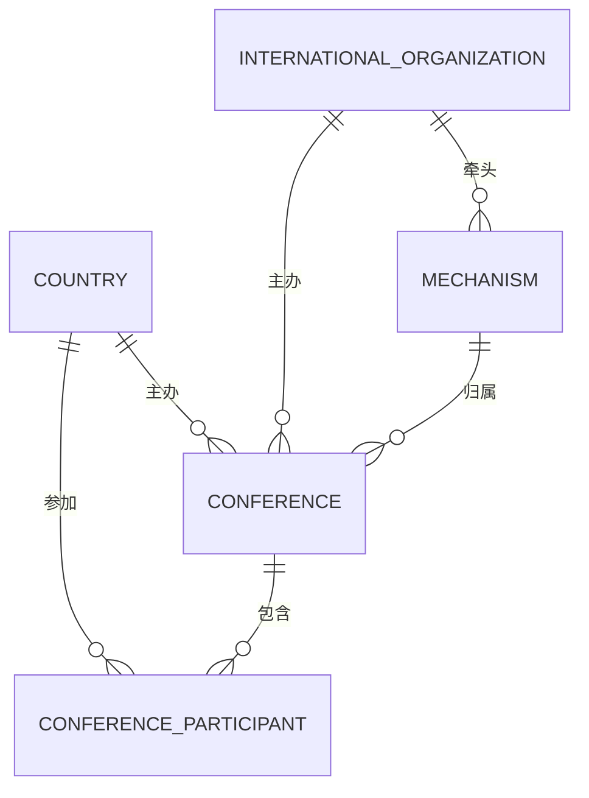
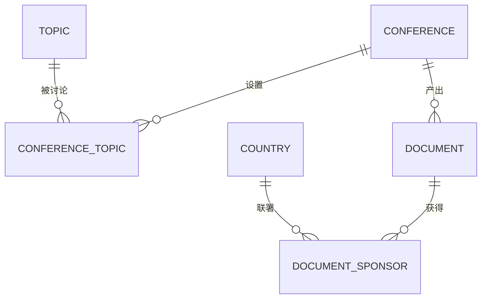
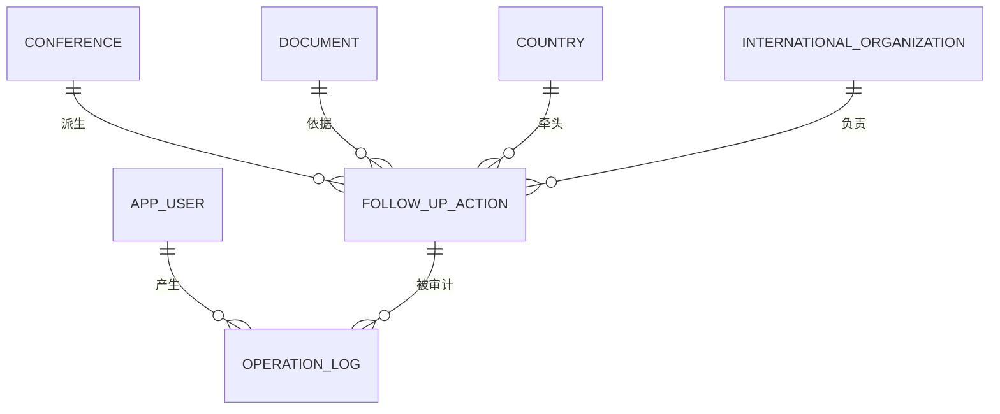
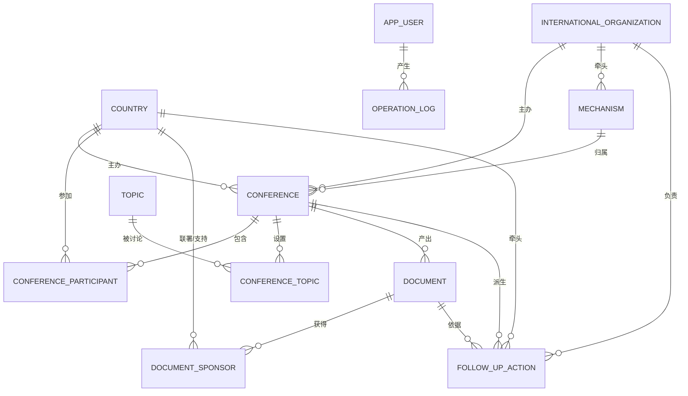

# 多边外交视角下国际会议与外交活动管理系统

《数据库原理》三级项目 · 选题 3 · 思政主题：多边外交 / 全球治理 · 难度系数 1.0（★★★）

数据库名：`` `multilateral-diplomacy-system-schoolwork-` ``（与仓库同名；含连字符，SQL 中必须加反引号）

> 本文件按课程数据库设计流程组织：系统分析 → 概念模型 → 逻辑模型 → 物理模型 → 数据库实现 → 总结。
> 当前03为50场真实会议录入版本；数据范围、来源、NULL规则和执行方法见[DATA_IMPORT.md](DATA_IMPORT.md)。
> 需要一个能点着看的界面时，用 [web/](web/)（零依赖 Node，`node web/server.js` → <http://127.0.0.1:8765>）。

---

## 第 1 章 系统分析

### 1.1 课题背景

多边外交活动是参与全球治理的主要形式。一场国际会议从筹备到收尾涉及主办国、参与国、国际组织、议题设置、成果文件、后续行动等多类对象，传统用文件与表格分散管理带来三类问题：会议与参会信息难以按机制汇总；成果文件与支持国之间缺乏可核验的对应关系；文件条款落地为行动后无人跟踪进度，逾期无预警。

本系统把"**国际会议 — 参与国家 — 议题 — 成果文件 — 后续行动**"建成一条可查询、可追踪、可审计的数据链。

### 1.2 需求分析

按使用角色划分需求（角色对应 `app_user.user_role`）：

| 角色 | 核心需求 |
|---|---|
| 系统管理员 | 账号与角色维护、操作留痕可追溯、数据备份还原 |
| 会议组织者 | 会议建档、参会登记、议题挂接、成果文件登记与联署记录 |
| 外交官 | 查询本国参会身份与出席级别、查看联署文件、跟踪牵头行动进度 |
| 观察员 | 只读查询会议全景与共识广度统计 |

功能需求归纳为六个模块：

1. **会议管理**：会议建档（机制、主办国、会期、形式、状态）
2. **参会管理**：国家参会登记（身份、出席级别、代表团规模）
3. **议题管理**：议题库维护与会议议题挂接（核心议题标记）
4. **成果文件管理**：文件登记（类型、编号、通过方式、状态）与联署国立场
5. **行动跟踪**：文件条款拆解为后续行动，进度与完成日期跟踪、逾期自动预警
6. **系统管理**：用户角色、操作审计

### 1.3 功能描述

```
                     ┌─────────────────────────────┐
                     │  多边外交会议与活动管理系统   │
                     └──────────────┬──────────────┘
   ┌──────────┬──────────┬──────────┼──────────┬──────────┬──────────┐
 会议管理   参会管理   议题管理   成果文件    行动跟踪   系统管理
   │          │          │          │          │          │
 会议建档   参会登记   议题挂接   文件登记   行动拆解   用户角色
 机制归属   身份级别   核心标记   联署立场   进度更新   操作审计
 会期形式   代表团规模 讨论要点   共识统计   逾期预警   数据备份
```

### 1.4 可行性分析

- **技术可行性**：MySQL 8.0.16 及以上版本支持本项目使用的外键、CHECK、视图、触发器与存储过程，本设计所需能力全部原生提供，无需额外组件。
- **数据可行性**：按外交部官网和国际组织资料采集50场会议、56份文件及304条参会记录，另用事务内虚构记录演示更新。
- **经济可行性**：全流程在单机完成，无授权费用。
- **操作可行性**：Navicat 图形界面 + 命令行脚本两条路径，组织者无需编程即可录入。

---

## 第 2 章 概念模型设计

按业务边界拆成三个局部 E-R 模型，再合成全局模型。

### 2.1 局部 E-R 模型

**（1）会议组织域**：回答"谁在什么机制下办了什么会、谁来了"。



**（2）议程与成果域**：回答"会上谈了什么、谈成了什么、谁赞同"。



**（3）行动与审计域**：回答"文件条款落实得怎么样、谁改的数据"。



### 2.2 全局 E-R 模型



---

## 第 3 章 逻辑模型设计

### 3.1 实体类型的转换

9 个实体各转换为一个关系，实体标识符作主键：

| 实体 | 关系 | 主键 |
|---|---|---|
| 国家 | `country` | `country_id` |
| 国际组织 | `international_organization` | `org_id` |
| 多边机制 | `mechanism` | `mechanism_id` |
| 议题 | `topic` | `topic_id` |
| 国际会议 | `conference` | `conference_id` |
| 成果文件 | `document` | `document_id` |
| 后续行动 | `follow_up_action` | `action_id` |
| 系统用户 | `app_user` | `user_id` |
| 操作日志 | `operation_log` | `log_id` |

> 说明：实体标识符统一采用**无业务含义的自增代理键**，业务唯一性（`iso_code`、`doc_no`、`username` 等）另以 UNIQUE 约束保证。

### 3.2 联系类型的转换

| 原有联系 | 类型 | 转换方式 | 结果关系 |
|---|---|---|---|
| 国家—会议 | M:N | 双方主键组成联合主键，加入联系属性 | `conference_participant`（身份、级别、人数、确认日期） |
| 会议—议题 | M:N | 双方主键组成联合主键，加入联系属性 | `conference_topic`（核心标记、讨论日期、要点） |
| 文件—国家 | M:N | 双方主键组成联合主键，加入立场属性 | `document_sponsor`（立场：联署/支持/保留） |
| 会议—文件 | 1:N | 在 N 端加入 1 端主键作外键 | `document.conference_id` |
| 会议—行动 | 1:N | 同上 | `follow_up_action.conference_id` |
| 文件—行动 | 1:N（可空） | 同上，允许为空（行动可只挂会议） | `follow_up_action.document_id` |
| 组织—机制 | 1:N | 同上 | `mechanism.lead_org_id` |
| 用户—日志 | 1:N | 同上 | `operation_log.user_id` |

### 3.3 关系模型

```
country(country_id, iso_code, name_cn, name_en, continent, development_status, is_un_member, note)
international_organization(org_id, name_cn, abbr, org_type, founded_year, hq_city)
mechanism(mechanism_id, name, abbr, category, founded_year, lead_org_id, description)
topic(topic_id, name, category, description)
conference(conference_id, title, short_name, mechanism_id, org_id, host_country_id,
           host_city, conference_type, session_label, start_date, end_date, format, status, theme)
conference_participant(conference_id, country_id, role, delegation_level,
                       delegation_size, join_date)
conference_topic(conference_id, topic_id, is_core, discussion_date, summary)
document(document_id, conference_id, title, doc_type, doc_no, issue_date, adopt_method, status, summary)
document_sponsor(document_id, country_id, stance)
follow_up_action(action_id, conference_id, document_id, action_name, lead_country_id,
                 responsible_org_id, start_date, planned_end_date, actual_end_date, progress_pct, status, remarks)
app_user(user_id, username, real_name, user_role, country_id, org_id, is_active, created_at)
operation_log(log_id, user_id, action_type, target_table, target_id, old_value, new_value, log_time, detail)
```

### 3.4 函数依赖与范式分析（课件第 4 章）

先依据业务语义列出函数依赖，再判断候选键及范式。不能仅凭“有自增主键”判断为 BCNF。

| 关系 | 主要候选键 | 函数依赖示例 |
|---|---|---|
| country | country_id、iso_code、name_cn | country_id → 国家名称、大洲等 |
| international_organization | org_id、name_cn | org_id → 名称、类型、成立年份、总部 |
| mechanism / topic | 各自主键、name | 主键 → 名称、类别等 |
| conference | conference_id | conference_id → 会名、机制、主办国、会期等 |
| conference_participant | (conference_id, country_id) | (会议, 国家) → 身份、级别、人数、确认日期 |
| conference_topic | (conference_id, topic_id) | (会议, 议题) → 核心标记、日期、要点 |
| document | document_id | document_id → conference_id、标题、类型等 |
| document_sponsor | (document_id, country_id) | (文件, 国家) → 立场 |
| follow_up_action | action_id | action_id → document_id、conference_id、进度等 |
| app_user / operation_log | user_id、username / log_id | 各自候选键 → 其余属性 |

`international_organization.abbr`、`document.doc_no` 允许 NULL，虽然有 UNIQUE 约束，也不能据此直接当作关系理论中的候选键。

- **1NF**：每格保存单值，参会国、议题和联署国分别存入联系表。
- **2NF**：联系表的身份、讨论要点、立场依赖整个复合候选键，不依赖其中一部分。
- **3NF**：国名和大洲只保存在 country，组织信息只保存在 international_organization，会议表通过外键引用，避免传递依赖。
- **保留的冗余**：follow_up_action 同时保存 conference_id 和可空的 document_id。填写文件时，存在 action_id → document_id → conference_id，document_id 不是行动表的超键，因此不能宣称该表满足 3NF/BCNF。为保留“仅挂会议”的原有用法，本次不改表结构；06 中的触发器检查文件与会议一致。这些检查不消除冗余；文件所属会议的修改由 `trg_document_before_update` 检查，拒绝造成已有行动与文件来源不一致的变更。

课件中的规范化思路可将带文件的行动分为“行动(action_id, document_id, …)”和“文件(document_id, conference_id, …)”。两者交集为 document_id，它决定文件关系，因此该分解无损；原依赖可通过 action_id → document_id → conference_id 推导。若要同时支持无文件的行动，还需单独设计会议关联。本项目将此作为后续结构调整，不写成已经完成的改动。


---

## 第 4 章 物理模型设计

### 4.1 数据字典

字段类型及主外键与 `02_create_tables.sql` 一致。分类值和布尔标记由 CHECK 限定；年份允许未知（NULL），已知年份范围为 1—9999。

#### 表 4-1  country 参与国家表

| 序号 | 列名 | 类型 | 允许空 | 键 | 默认值 | 说明 |
|---|---|---|---|---|---|---|
| 1 | `country_id` | int | 否 | 主键 |  | 国家ID；自增 |
| 2 | `iso_code` | char(3) | 否 | 唯一 |  | ISO三位代码 |
| 3 | `name_cn` | varchar(50) | 否 | 唯一 |  | 国家名称(中文) |
| 4 | `name_en` | varchar(80) | 否 |  |  | 国家名称(英文) |
| 5 | `continent` | varchar(10) | 否 | 索引 |  | 所属大洲 |
| 6 | `development_status` | varchar(10) | 是 |  | | 发展类别；本次未统一核验 |
| 7 | `is_un_member` | smallint | 否 |  | 1 | 是否联合国成员国 |
| 8 | `note` | varchar(200) | 是 |  |  | 备注 |

#### 表 4-2  international_organization 国际组织表

| 序号 | 列名 | 类型 | 允许空 | 键 | 默认值 | 说明 |
|---|---|---|---|---|---|---|
| 1 | `org_id` | int | 否 | 主键 |  | 组织ID；自增 |
| 2 | `name_cn` | varchar(80) | 否 | 唯一 |  | 组织中文名 |
| 3 | `abbr` | varchar(20) | 是 | 唯一 |  | 组织简称 |
| 4 | `org_type` | varchar(10) | 否 |  |  | 组织类型 |
| 5 | `founded_year` | smallint | 是 |  |  | 成立年份 |
| 6 | `hq_city` | varchar(50) | 是 |  |  | 总部所在地 |

#### 表 4-3  mechanism 多边机制表

| 序号 | 列名 | 类型 | 允许空 | 键 | 默认值 | 说明 |
|---|---|---|---|---|---|---|
| 1 | `mechanism_id` | int | 否 | 主键 |  | 机制ID；自增 |
| 2 | `name` | varchar(80) | 否 | 唯一 |  | 机制名称 |
| 3 | `abbr` | varchar(20) | 是 |  |  | 机制简称 |
| 4 | `category` | varchar(10) | 否 |  |  | 机制类别 |
| 5 | `founded_year` | smallint | 是 |  |  | 启动年份 |
| 6 | `lead_org_id` | int | 是 | 外键 |  | 牵头组织 |
| 7 | `description` | varchar(200) | 是 |  |  | 机制说明 |

#### 表 4-4  topic 议题表

| 序号 | 列名 | 类型 | 允许空 | 键 | 默认值 | 说明 |
|---|---|---|---|---|---|---|
| 1 | `topic_id` | int | 否 | 主键 |  | 议题ID；自增 |
| 2 | `name` | varchar(60) | 否 | 唯一 |  | 议题名称 |
| 3 | `category` | varchar(10) | 否 | 索引 |  | 议题领域 |
| 4 | `description` | varchar(200) | 是 |  |  | 议题说明 |

#### 表 4-5  conference 国际会议表

| 序号 | 列名 | 类型 | 允许空 | 键 | 默认值 | 说明 |
|---|---|---|---|---|---|---|
| 1 | `conference_id` | int | 否 | 主键 |  | 会议ID；自增 |
| 2 | `title` | varchar(120) | 否 |  |  | 会议全称 |
| 3 | `short_name` | varchar(60) | 是 |  |  | 会议简称 |
| 4 | `mechanism_id` | int | 是 | 外键 |  | 所属机制 |
| 5 | `org_id` | int | 是 | 外键 |  | 主办国际组织 |
| 6 | `host_country_id` | int | 是 | 外键 | | 举办地国家；纯线上可空 |
| 7 | `host_city` | varchar(60) | 是 |  |  | 举办城市 |
| 8 | `conference_type` | varchar(10) | 否 |  |  | 会议类型 |
| 9 | `session_label` | varchar(20) | 是 |  |  | 届次(如 第24次) |
| 10 | `start_date` | date | 否 | 索引 |  | 开始日期 |
| 11 | `end_date` | date | 否 |  |  | 结束日期 |
| 12 | `format` | varchar(10) | 是 |  | | 会议形式；未知为NULL |
| 13 | `status` | varchar(10) | 否 |  | 已闭幕 | 会议状态 |
| 14 | `theme` | varchar(200) | 是 |  |  | 会议主题 |

#### 表 4-6  conference_participant 会议参与国家表

联合主键：`(conference_id, country_id)`。

| 序号 | 列名 | 类型 | 允许空 | 键 | 默认值 | 说明 |
|---|---|---|---|---|---|---|
| 1 | `conference_id` | int | 否 | 主键/外键 |  | 会议ID |
| 2 | `country_id` | int | 否 | 主键/外键 |  | 国家ID |
| 3 | `role` | varchar(10) | 否 |  | 成员国 | 参会身份 |
| 4 | `delegation_level` | varchar(10) | 是 |  | | 出席级别；未知为NULL |
| 5 | `delegation_size` | int | 是 |  | | 代表团人数；未知为NULL |
| 6 | `join_date` | date | 是 |  |  | 确认参会日期 |

#### 表 4-7  conference_topic 会议议题关联表

联合主键：`(conference_id, topic_id)`。

| 序号 | 列名 | 类型 | 允许空 | 键 | 默认值 | 说明 |
|---|---|---|---|---|---|---|
| 1 | `conference_id` | int | 否 | 主键/外键 |  | 会议ID |
| 2 | `topic_id` | int | 否 | 主键/外键 |  | 议题ID |
| 3 | `is_core` | smallint | 是 |  | | 是否核心议题；未知为NULL |
| 4 | `discussion_date` | date | 是 |  |  | 讨论日期 |
| 5 | `summary` | varchar(300) | 是 |  |  | 议题讨论要点 |

#### 表 4-8  document 成果文件表

| 序号 | 列名 | 类型 | 允许空 | 键 | 默认值 | 说明 |
|---|---|---|---|---|---|---|
| 1 | `document_id` | int | 否 | 主键 |  | 文件ID；自增 |
| 2 | `conference_id` | int | 否 | 外键 |  | 所属会议 |
| 3 | `title` | varchar(120) | 否 |  |  | 文件名称 |
| 4 | `doc_type` | varchar(10) | 否 | 索引 |  | 文件类型 |
| 5 | `doc_no` | varchar(40) | 是 | 唯一 |  | 文件编号 |
| 6 | `issue_date` | date | 否 |  |  | 发布/通过日期 |
| 7 | `adopt_method` | varchar(10) | 是 |  | | 通过方式；未知为NULL |
| 8 | `status` | varchar(10) | 否 |  | 已通过 | 文件状态 |
| 9 | `summary` | varchar(300) | 是 |  |  | 内容概要 |

#### 表 4-9  document_sponsor 文件联署/支持国家表

联合主键：`(document_id, country_id)`。

| 序号 | 列名 | 类型 | 允许空 | 键 | 默认值 | 说明 |
|---|---|---|---|---|---|---|
| 1 | `document_id` | int | 否 | 主键/外键 |  | 文件ID |
| 2 | `country_id` | int | 否 | 主键/外键 |  | 国家ID |
| 3 | `stance` | varchar(10) | 否 |  | 联署 | 国别立场 |

#### 表 4-10  follow_up_action 后续行动表

| 序号 | 列名 | 类型 | 允许空 | 键 | 默认值 | 说明 |
|---|---|---|---|---|---|---|
| 1 | `action_id` | int | 否 | 主键 |  | 行动ID；自增 |
| 2 | `conference_id` | int | 否 | 外键 |  | 来源会议 |
| 3 | `document_id` | int | 是 | 外键 |  | 依据文件 |
| 4 | `action_name` | varchar(120) | 否 |  |  | 行动名称 |
| 5 | `lead_country_id` | int | 是 | 外键 | | 牵头国家；集体目标可空 |
| 6 | `responsible_org_id` | int | 是 | 外键 |  | 责任国际组织 |
| 7 | `start_date` | date | 是 |  |  | 精确启动日期；未知为NULL |
| 8 | `planned_end_date` | date | 是 | 索引 | | 精确计划完成日期；未知为NULL |
| 9 | `actual_end_date` | date | 是 |  |  | 实际完成日期(未完成为NULL) |
| 10 | `progress_pct` | int | 是 |  | | 进度百分比；未知为NULL |
| 11 | `status` | varchar(10) | 是 |  |  | 执行状态；未知为NULL |
| 12 | `remarks` | varchar(200) | 是 |  |  | 备注 |

#### 表 4-11  app_user 系统用户表

| 序号 | 列名 | 类型 | 允许空 | 键 | 默认值 | 说明 |
|---|---|---|---|---|---|---|
| 1 | `user_id` | int | 否 | 主键 |  | 用户ID；自增 |
| 2 | `username` | varchar(40) | 否 | 唯一 |  | 登录账号 |
| 3 | `real_name` | varchar(40) | 否 |  |  | 姓名 |
| 4 | `user_role` | varchar(10) | 否 | 索引 | 观察员 | 角色 |
| 5 | `country_id` | int | 是 | 外键 |  | 所属国家 |
| 6 | `org_id` | int | 是 | 外键 |  | 所属国际组织 |
| 7 | `is_active` | smallint | 否 |  | 1 | 是否启用 |
| 8 | `created_at` | datetime | 否 |  | CURRENT_TIMESTAMP | 创建时间 |

#### 表 4-12  operation_log 操作审计表

| 序号 | 列名 | 类型 | 允许空 | 键 | 默认值 | 说明 |
|---|---|---|---|---|---|---|
| 1 | `log_id` | bigint | 否 | 主键 |  | 日志ID；自增 |
| 2 | `user_id` | int | 是 | 外键 |  | 操作人(周界外为NULL) |
| 3 | `action_type` | varchar(10) | 否 |  |  | 操作类型 |
| 4 | `target_table` | varchar(40) | 否 | 索引 |  | 目标表 |
| 5 | `target_id` | int | 是 |  |  | 目标记录主键 |
| 6 | `old_value` | varchar(200) | 是 |  |  | 变更前摘要 |
| 7 | `new_value` | varchar(200) | 是 |  |  | 变更后摘要 |
| 8 | `log_time` | datetime | 否 | 索引 | CURRENT_TIMESTAMP | 记录时间 |
| 9 | `detail` | varchar(300) | 是 |  |  | 说明 |

### 4.2 索引设计

主键和 UNIQUE 由数据库建立对应索引，外键缺少可用索引时由 InnoDB 自动建立。查询所需的普通索引按课件 3.2.4 使用独立的 CREATE INDEX，统一放在建表文件末尾。

| 索引 | 所在表 | 作用 |
|---|---|---|
| `idx_country_continent` | country | 按大洲筛选国家 |
| `idx_topic_category` | topic | 按议题领域筛选 |
| `idx_conf_dates(start_date, end_date)` | conference | 按会期筛选 |
| `idx_doc_type` | document | 按文件类型统计 |
| `idx_action_due` | follow_up_action | 按计划日期筛选行动 |
| `idx_user_role` | app_user | 按用户角色筛选 |
| `idx_log_time` | operation_log | 按日志时间查询 |
| `idx_log_target(target_table, target_id)` | operation_log | 按操作对象追溯 |

显式查询索引共 8 个；当前全库共 43 个索引（含主键、唯一及外键所需索引）。是否采用某个索引，由优化器结合查询与数据分布决定。

### 4.3 数据量估算与存储

| 对象 | 单行估算 | 3 年规模 | 空间估算 |
|---|---|---|---|
| conference | ~400 B | 500 场 | 0.2 MB |
| conference_participant | ~120 B | 2 万条 | 2.4 MB |
| document_sponsor | ~30 B | 3 万条 | 0.9 MB |
| follow_up_action | ~300 B | 5000 条 | 1.5 MB |
| operation_log | ~300 B | 10 万条 | 30 MB |
| 合计 | — | — | < 50 MB |

参数选择：存储引擎 `InnoDB`（事务 + 外键）、字符集 `utf8mb4`（中文与符号无损）、排序规则继承 MySQL 的 utf8mb4 默认值；日志表主键用 `BIGINT` 为增长预留；时间统一 `DATE`（业务日）与 `DATETIME`（日志时刻）。

---

## 第 5 章 数据库实现

### 5.1 脚本清单与执行顺序

| 顺序 | 文件 | 对应内容 |
|---|---|---|
| 1 | `01_create_database.sql` | 建库（utf8mb4） |
| 2 | `02_create_tables.sql` | 12 张表 + 主键/外键/CHECK/UNIQUE + 索引 |
| 3 | `03_insert_data.sql` | 50场真实会议及关联资料（空表首次执行） |
| 4 | `04_views.sql` | 6 个视图（可单独重跑） |
| 5 | `06_routines.sql` | 4 触发器 + 1 存储过程 + 1 函数 |
| 6 | `05_queries.sql` | 14 条核心查询 |
| 7 | `07_crud_samples.sql` | S06—S10增删改、触发器、综合统计及回滚 |
| 8 | `08_course_examples.sql` | 条件、自身连接、IN、ANY/ALL、UNION、空值及视图更新 |
| 9 | `99_verify.sql` | 验收自检 |
| 单独演示 | `09_constraint_samples.sql` | S11—S16：11条故意违反语句及拒绝后的核对；不加入正常建库流程 |

### 5.2 数据规模

| 表 | 行数 | 表 | 行数 |
|---|---|---|---|
| country | 69 | document | 56 |
| international_organization | 3 | document_sponsor | 45 |
| mechanism | 17 | follow_up_action | 38 |
| topic | 101 | app_user | 0（实际使用时创建） |
| conference | 50 | operation_log | 0（实际操作时生成） |
| conference_participant | 304 | conference_topic | 103 |

### 5.3 样例设计与实际运行结果

[SAMPLES.md](SAMPLES.md)按“3.4 样例”要求给出16个样例，包含5个复杂查询；每个样例展示SQL和MySQL实际结果，违规样例展示原始错误及拒绝后的数据核对。

07在事务内演示VALUES、INSERT ... SELECT、带子查询的UPDATE/DELETE、自动逾期、自动完成与审计，再ROLLBACK。相对日期保证演示不依赖固定日历日期；虚构数据不留在真实资料中，自增编号可能留下空号。

08的ANY/ALL对已登记参会国数作聚合比较，不拿未公开的人数和进度补造数值。可更新视图先插入事务内演示用户，保证实际修改一行。09进一步测试主键、UNIQUE、外键、CHECK、触发器一致性和WITH CHECK OPTION，共11次预期拒绝；须逐条运行或仅对09使用mysql --force。

### 5.4 验证环境

50场真实资料录入验证见[DATA_IMPORT.md](DATA_IMPORT.md)。2026-10-27在MySQL 8.4.11独立临时实例实测16个正式样例及11条预期拒绝，07—09重复执行后原始数据一致；详细SQL、结果及日志见[SAMPLES.md](SAMPLES.md)。以下为此前版本的验证记录。

2026-10-27启动脚本调整：通过sh和Bash下20项路径、参数及失败处理检查；独立MySQL 8.4.11实测重建成功（12表、6视图、4触发器、2例程、50场会议）。SQL出错时即使传入或配置了force仍会停止；网页专用账号、自定义客户端及socket连接、只读接口验证通过。本次未在Windows、macOS原生环境执行。

2026-10-24，MySQL 8.4.11，utf8mb4，严格模式及 ONLY_FULL_GROUP_BY。在独立临时实例完成 63 项执行及约束检查：建表文件在外键检查开启时重跑成功；原有示例数据正常导入；修改前后 14 条核心查询结果一致；非法分类、布尔标记、年份、重复参会、外键及日期范围均受约束；文件换会议的一致性检查通过；CRUD 与视图示例回滚后各表数据恢复；Linux 一键入口重建成功。Windows 入口本次未运行。

备份首次和重复恢复另行核对，备份不含固定 DEFINER。

此前版本的 Windows 验证记录：Windows 11 + **MySQL 9.4.0**（服务 `MySQL94`，端口 3306，utf8mb4，严格模式及 ONLY_FULL_GROUP_BY）：

- `run_all.ps1` 全链路通过（01→02→03→04→06→05→07→08→99），结果 **12 表 / 6 视图 / 3 触发器 / 2 例程**、259 行示例数据；
- `04`、`06`、`07`、`08` 单独重复执行两次均成功：视图/触发器/例程可重复创建，CRUD 与视图更新演示回滚后数据不变；
- 约束拦截实测：外键 `1452`、CHECK `3819`、父行删除 `1451`、视图 `WITH CHECK OPTION` → `1369`、触发器文件/会议不匹配 → `1644`；
- 整库备份（`backup/…_full.sql`）导入临时库后 12 张表行数逐一一致，视图/触发器/例程齐全。

更早版本在 MySQL 8.4.11 独立实例上完成过 35 项检查。上述 Windows 记录针对调整前的版本；本次新增约束及第 4 个触发器以本节开头的验证结果为准。

### 5.5 核心查询一览（14 条）

| # | 查询 | 主要语法 |
|---|---|---|
| 1 | 会议全景 | 视图查询、ORDER BY |
| 2 | 机制维度统计 | COUNT、相关子查询、等值连接 |
| 3 | 参与国不少于 8 个的会议 | GROUP BY、HAVING |
| 4 | 尚未关联后续行动的文件 | 相关子查询、NOT EXISTS |
| 5 | 各国主办会议数（含 0） | LEFT JOIN、COUNT、排序 |
| 6 | 行动逾期预警 | 视图、日期表达式 |
| 7 | 文件共识广度 | 分组视图、排序 |
| 8 | 议题热度 | 分组、条件求和 |
| 9 | 中国参与全景 | 基于视图的视图，仅统计“联署”立场 |
| 10 | 行动状态分布 | COUNT、AVG、GROUP BY |
| 11 | 年度会议统计 | YEAR、GROUP BY |
| 12 | 参加中国所参加全部会议的国家 | 双重 NOT EXISTS（关系除法） |
| 13 | 用户角色分布 | 分组、条件求和 |
| 14 | 操作审计日志 | 视图、倒序排列 |

主查询使用课件讲授的关系操作。CASE 为条件表达式，YEAR、DATEDIFF、CURDATE 为 MySQL 日期函数。更多基础语法及与课件的对应关系见 [COURSE_ALIGNMENT.md](COURSE_ALIGNMENT.md)。

### 5.6 视图 / 触发器 / 例程

| 类型 | 名称 | 作用 |
|---|---|---|
| 视图 | `v_conference_overview` | 会议全景（参与国/议题/文件/行动计数） |
| 视图 | `v_document_consensus` | 文件共识广度（联署/支持/保留分项） |
| 视图 | `v_action_alert` | 逾期行动预警（含逾期天数） |
| 视图 | `v_china_multilateral` | 中国多边参与全景（思政报表） |
| 视图 | `v_operation_audit` | 操作审计（关联用户与角色） |
| 视图 | `v_active_user` | 单表可更新视图，WITH CHECK OPTION 保证启用条件 |
| 触发器 | `trg_document_before_update` | 防止文件换会议后与已有关联行动不一致 |
| 触发器 | `trg_action_before_insert` | 插入时按计划日期判定逾期 |
| 触发器 | `trg_action_before_update` | 更新时按完成日期判定已完成并置进度 100 |
| 触发器 | `trg_action_audit` | 状态/进度变化写审计日志 |
| 存储过程 | `sp_conference_dashboard(会议ID)` | 一次输出 5 个结果集（基本信息/参会/议题/文件含共识率/行动） |
| 函数 | `fn_consensus_ratio(文件ID)` | 文件联署率（%） |

### 5.7 整库备份

[旧版示例备份](backup/multilateral-diplomacy-system-schoolwork-_full.sql)未包含本次50场真实资料及本次表结构调整。需要当前版本时按01—03重建；该备份仅用于恢复旧版演示。

```bash
# 会覆盖同名表与数据；请先备份已有内容
mysql -u root -p --default-character-set=utf8mb4 < project/backup/multilateral-diplomacy-system-schoolwork-_full.sql
```

Windows 可在 Navicat 的“运行 SQL 文件”中选择该文件。脚本正常执行顺序为 `01 → 02 → 03 → 04 → 06 → 05 → 07 → 08 → 99`。Windows入口通过PATH查找mysql.exe，也可指定`-MySqlPath`；Linux/macOS在项目根目录运行`sh project/run_all.sh -u root -p`。若本机root使用系统身份认证，改用`sudo sh project/run_all.sh -u root`。

sh入口按自身目录读取SQL，兼容中文及空格路径；一次连接完成全部步骤，任何SQL出错即停止。自定义客户端用`MYSQL_BIN`，连接选项直接追加给MySQL；`sh project/run_all.sh --help`可查看说明。09的故意违规测试不包含在初始化中。网页通过`sh project/web/start.sh`启动，要求Node.js 18+，连接配置见[网页说明](web/README.md)。


---

## 第 6 章 总结

### 6.1 遇到的问题与解决方法

| 问题 | 原因 | 解决 |
|---|---|---|
| 分类字段写入非法值，报 `ERROR 3819` | VARCHAR 的值未通过 CHECK，例如出席级别不在允许范围内 | 在 02 的 CHECK 中统一定义取值范围，导入后逐表核对行数 |
| 自检脚本显示行动表 0 行，实际有 16 行 | `information_schema.table_rows` 是 InnoDB 估算值 | 改用 `COUNT(*)` |
| 库名含连字符导致语法错误 | 标识符需反引号 | 全库 SQL 统一反引号；命令行可用 `-D` 传库名 |
| 重跑脚本时主键冲突 / 数据翻倍 | 脚本不幂等 | 建表前 `DROP IF EXISTS`；03在新版空表首次执行，视图使用 `CREATE OR REPLACE` |
| 一键脚本双击报"未对文件进行数字签名" | Windows 默认执行策略 | 提供 `.cmd` 外壳用 `-ExecutionPolicy Bypass` 只对本次放行 |

### 6.2 心得体会

> （本节由本人撰写：围绕多边外交数据建模的取舍、范式与业务规则如何落到数据库层、以及团队分工与答辩准备的体会。）

---

## 附 A：评分点对照

| 评分维度（三级项目） | 分值 | 对应内容 |
|---|---|---|
| 项目完整度（需求与流程） | 10 | 1.2 角色需求 + 1.3 功能模块 + 第 5 章完整闭环 |
| 关系模型设计（ER 图与逻辑） | 20 | 2.1 三个局部 E-R + 2.2 全局 E-R；3.1–3.3 转换；3.4 的函数依赖与范式分析（说明行动表的冗余）；18 外键 / 29 CHECK / 8 UNIQUE 全生效 |
| 思政元素体现 | 10 | 1.1 背景；`v_china_multilateral`；查询 7/9 量化共识广度与发展中国家代表性 |
| 功能概述与数据（实现） | 30 | 14 条核心查询；50场真实会议及关联资料；未知执行状态不编造，状态变更在07中演示；5.3 CRUD 演示；5.3 约束与 5.4 验证记录 |
| 展示（验收演示） | 30 | `run_all.cmd` 一键重建；`99_verify.sql` 自检；`CALL sp_conference_dashboard(3)` 一屏看全链条 |
| 加分项 | 10 | 逾期预警、审计触发器、6 视图、1 过程 1 函数与事务演示 |

## 附 B：答辩演示清单

1. `run_all.cmd` 一键重建 → 停在 `99_verify` 输出（表齐、约束齐、对象齐）
2. Navicat 展开库 → 12 张表、外键连线、`follow_up_action` 的 5 个 CHECK
3. 跑 `07_crud_samples.sql` → 增删改查 + 触发器联动 + 审计留痕 + 事务回滚
4. 按09逐条或使用mysql --force演示预期拒绝，对照SAMPLES中的实际错误与原行核对
5. `CALL sp_conference_dashboard(3);` → 中非论坛北京峰会全链条一屏看完
6. 查询 6 逾期预警 + 查询 9 中国参与全景 → 思政落到数据上

**需要截图的位置**：库与表树、每表设计视图、外键页、各表数据、约束报错、14 条核心查询结果、08 的课件示例、过程输出、审计日志。
